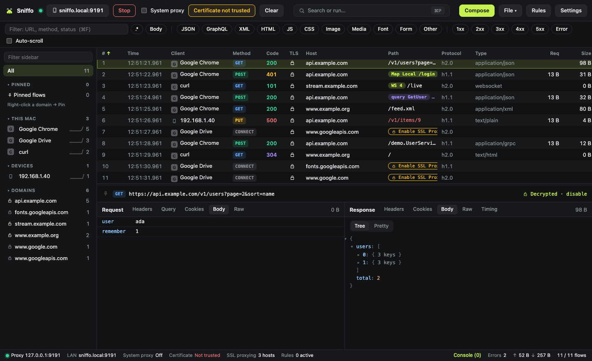
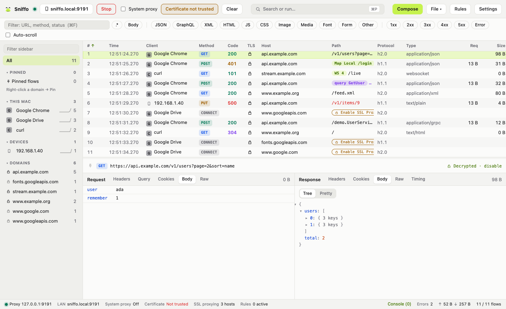
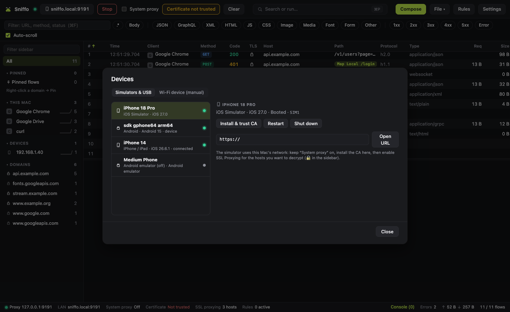
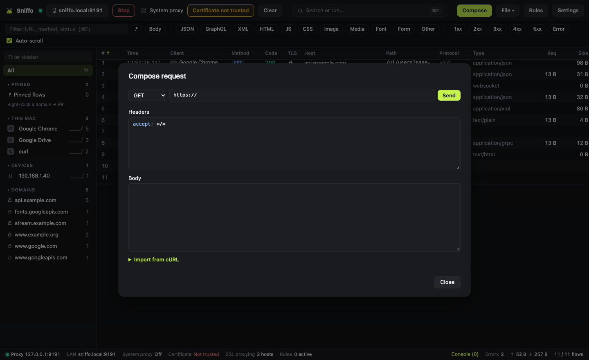
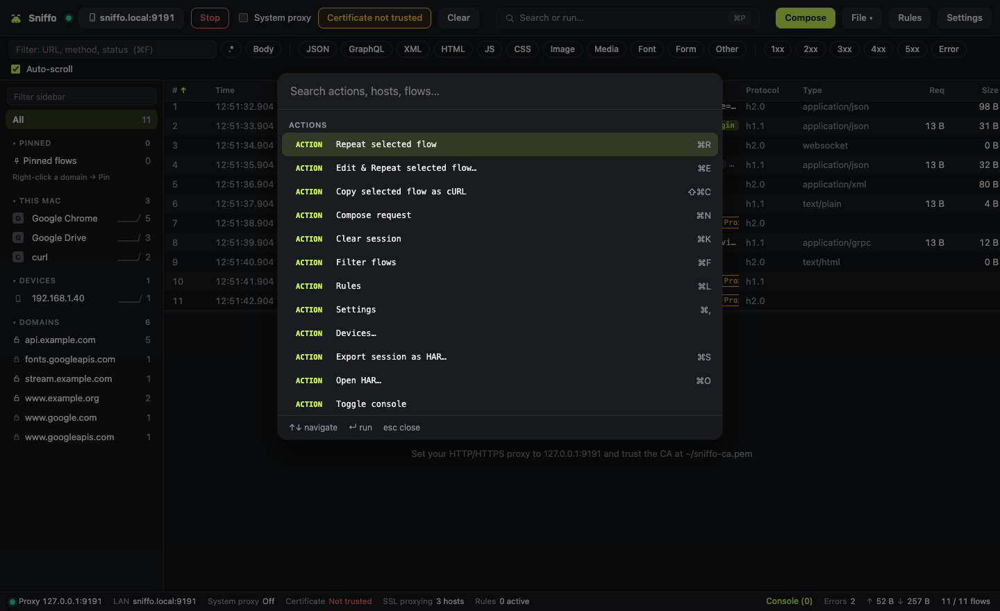

<p align="center">
  
</p>

<h1 align="center">Sniffo</h1>

<p align="center">
  A free, cross-platform HTTP/HTTPS debugging proxy for macOS (Windows and Linux coming later).<br>
  Every feature is included; nothing is behind a paid tier.
</p>

<p align="center">
  <a href="docs/getting-started.md">Get started</a> ·
  <a href="docs/features.md">Features</a> ·
  <a href="docs/development.md">Development</a> ·
  <a href="CONTRIBUTING.md">Contributing</a>
</p>



## Install

```bash
brew install --cask alexma01/tap/sniffo
```

Or download the `.dmg` from the [releases](https://github.com/alexma01/sniffo/releases). Details in [Getting started](docs/getting-started.md).

## Why Sniffo

- **See everything**: HTTP/1.1, HTTP/2, HTTPS, WebSocket, GraphQL and gRPC traffic, from this machine, LAN devices, iOS Simulator and Android.
- **One-click setup**: local root CA and system proxy, restored on exit and after a crash.
- **Change traffic on the fly**: breakpoints, Map Local, Map Remote, Block, throttling and JavaScript rules. Unlimited.
- **Native and light**: built with [Tauri 2](https://tauri.app), a Rust proxy core and a React UI.

## Screenshots

| Light theme | Devices |
|---|---|
|  |  |
| **Compose** | **Command palette** |
|  |  |

## Documentation

| I want to… | Read |
|---|---|
| Install Sniffo and capture my first request | [Getting started](docs/getting-started.md) |
| Know everything Sniffo can do | [Features](docs/features.md) |
| Build and run it from source, run the tests | [Development](docs/development.md) |
| Send a fix or a feature | [Contributing](CONTRIBUTING.md) |
| Work on it with an AI coding agent | [AGENTS.md](AGENTS.md) |

## License

Apache-2.0. See [LICENSE](LICENSE).
