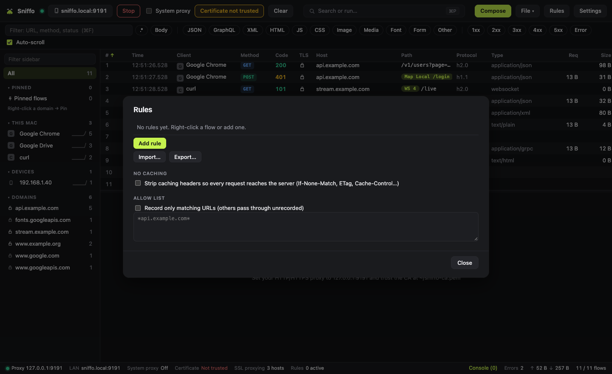
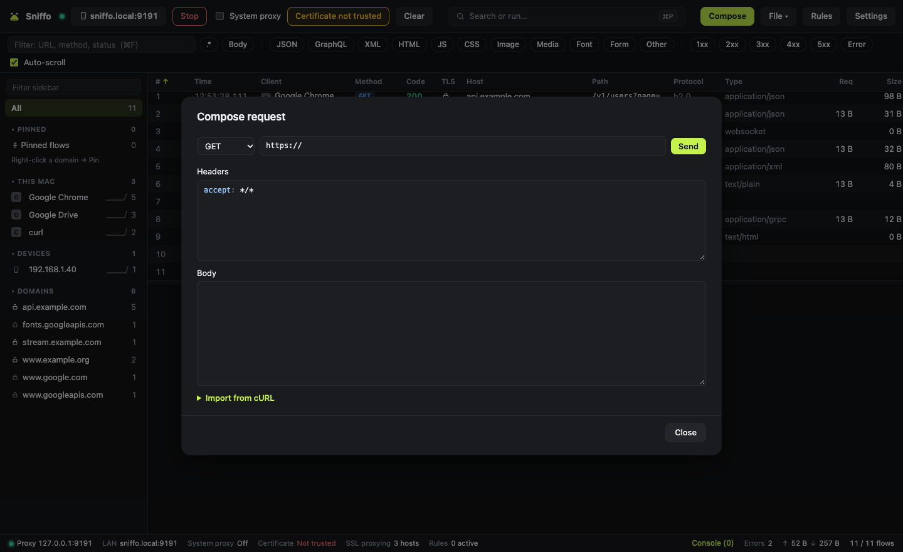
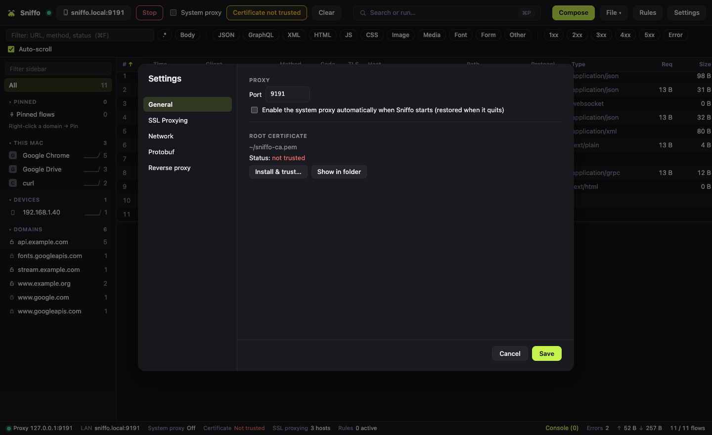
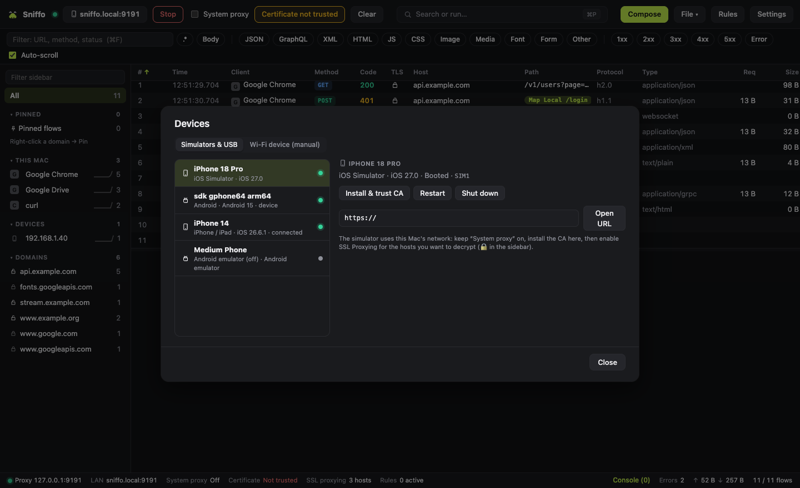

# Features

[← README](../README.md)

Every feature is free and unlimited.

## Capture

- HTTP/1.1, HTTP/2 and HTTPS (MITM), with SSL Proxying per host (include/exclude wildcards).
- Streaming responses (SSE, downloads) keep working while they're recorded.
- Local root CA, installed and trusted in one click on macOS.
- System proxy on and off in one click; previous settings saved and restored on exit and after a crash.
- Or capture a single app: open Chrome, Edge, Brave, Chromium or Firefox with its own profile already pointed at Sniffo, or paste the terminal setup (proxy and CA variables for curl, Node, Python, git, Go, Rust…).

## Inspect

- Virtualized list with configurable columns: client app, TLS, protocol, sizes, TTFB, duration.
- Filters by content type and status, regex, full-text search in headers and bodies.
- Sidebar by domain, app and device; pinning, color highlights and comments (saved in HAR); status bar.
- Detail: headers, query, cookies, body (JSON tree, XML, form, multipart, images, hex), raw and timing.
- Request/response diff.

## Change traffic

- Request and response breakpoints with editing.
- Map Local (inline or from a file), Map Remote, Block, allow list, No Caching.
- Rewrite without code: set, remove or regex-replace headers, query parameters, URL, status and body.
- Throttling with latency and bandwidth presets.
- JavaScript `onRequest` / `onResponse` rules (QuickJS) with `sharedState` and a console.

## Replay and share

- Repeat, Edit & Repeat, Compose (with cURL import).
- Copy as cURL, fetch or Python.
- HAR import/export; sessions saved as HAR.

## Protocols

- WebSocket frames, with message injection.
- GraphQL operations.
- Protobuf and gRPC decoding without a schema.

## Network

- Upstream HTTP or SOCKS5 proxy.
- DNS overrides, reverse proxy.
- Option to ignore upstream TLS errors (dev servers).

## Language

- English and Italian, switched live in Settings → General. Defaults to the system language.

## Devices

- LAN mode with a QR code and a certificate page at `http://sniffo.cert`.
- iOS Simulator: CA install, boot and restart.
- Android emulators and USB devices: proxy via `adb reverse`, user or system CA, reboot.

